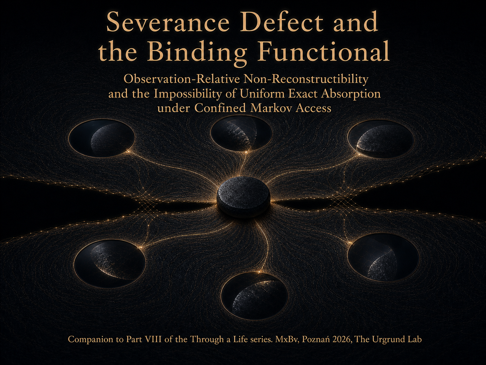

<p align="center">
  
</p>

# Severance Defect and the Binding Functional

## Observation-Relative Non-Reconstructibility and the Impossibility of Uniform Exact Absorption under Confined Markov Access

**Author:** Maksim Barziankou (MxBv)  
**Affiliation:** PETRONUS™ · The Urgrund Laboratory  
**Released:** July 2026  
**DOI:** [10.17605/OSF.IO/5VJMR](https://doi.org/10.17605/OSF.IO/5VJMR)  
**License:** CC BY-NC-ND 4.0  
**Publication pair:** Formal companion to *Nothing Is Solid: Atomicity, Emptiness, and the Source of Structural Gravity*  

This repository contains the formal companion to Part VIII of *Through a Life*. It separates functional severance from reconstructive binding, records them as a two-coordinate severance profile, and studies exact reconstruction through a declared observation channel.

## Core results

- A finite full-support reconstruction criterion expressed through injectivity, singleton fibres, a left inverse, and zero conditional entropy.
- An exact entropy decomposition for coupled assembly, including the compatibility correction.
- A non-absorption theorem: positive binding under confined Markov access forbids uniform exact reconstruction of the declared floor class.
- Three sealed finite examples occupying the strong-binding quadrant and both off-diagonal quadrants.
- A standard-library executable verifier extracted verbatim from Appendix A.7.

## Repository map

| Path | Contents |
|---|---|
| [paper/Severance_Defect_and_the_Binding_Functional.md](paper/Severance_Defect_and_the_Binding_Functional.md) | Canonical Markdown source |
| [paper/Severance Defect and the Binding Functional (2026).pdf](<paper/Severance Defect and the Binding Functional (2026).pdf>) | Protected publication PDF |
| [code/severance_audit_verifier.py](code/severance_audit_verifier.py) | Executable Appendix A.7 verifier |
| [assets/Severance_Defect_and_the_Binding_Functional-cover.png](assets/Severance_Defect_and_the_Binding_Functional-cover.png) | Publication cover |
| [provenance/](provenance/) | Detached GPG signatures and OpenTimestamps proof |
| [SHA256SUMS](SHA256SUMS) | Artifact hashes |

## Reproduce the verifier

The verifier uses only the Python standard library.

```bash
python code/severance_audit_verifier.py
```

Expected output:

```text
target: S_plus
witness: S_minus
budget verdicts: 1 0
fibre size: 2
delta_C: 1
binding_bits: 1.0
profile: (1, 1.0)
edge_profile: (1, 0.0)
same_verdict_capacity_profile: (0, 1.0)
```

## Verify provenance

Import the PETRONUS Research public key, then run:

```bash
gpg --verify "provenance/Severance_Defect_and_the_Binding_Functional.md.sig" "paper/Severance_Defect_and_the_Binding_Functional.md"
gpg --verify "provenance/Severance Defect and the Binding Functional (2026).pdf.sig" "paper/Severance Defect and the Binding Functional (2026).pdf"
gpg --verify "provenance/Severance_Defect_and_the_Binding_Functional-cover.png.sig" "assets/Severance_Defect_and_the_Binding_Functional-cover.png"
ots verify "provenance/Severance_Defect_and_the_Binding_Functional.md.ots"
```

## Publication pair

The formal note and [*Nothing Is Solid*](https://petronus.eu/blog/essay-through-a-life-part-viii/) form one two-part publication under the shared DOI [10.17605/OSF.IO/5VJMR](https://doi.org/10.17605/OSF.IO/5VJMR).

## Boundary recomposition addendum

[*Boundary Recomposition with Ordered Witnesses*](<addendum/Boundary Recomposition with Ordered Witnesses (2026).md>) gives a finite construction for contracting and replacing graph components while retaining an ordered window trace. It distinguishes preserved totals from the location of a capacity crossing. The addendum uses the same DOI as this publication pair.

- [Protected PDF](<addendum/Boundary Recomposition with Ordered Witnesses (2026).pdf>)
- [Source archive](<addendum/Boundary Recomposition with Ordered Witnesses - Sources (2026).zip>)

The archive supplies an overlay for the pinned TECTONICA checkout described in the addendum. Each of the three files has a detached GPG signature and an OpenTimestamps proof beside it.

## License

The paper, executable verifier, and cover are distributed under CC BY-NC-ND 4.0. No separate software licence is granted.
